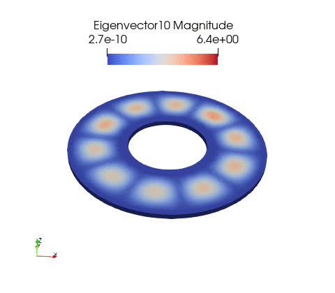
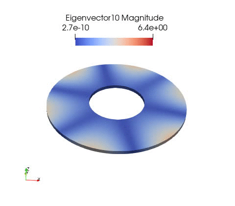
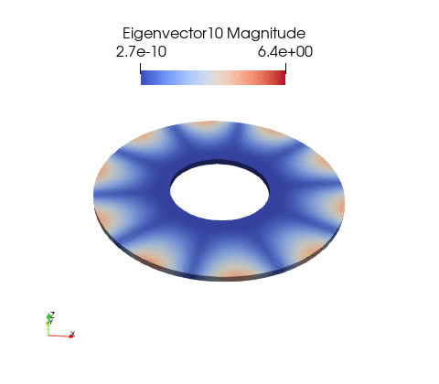
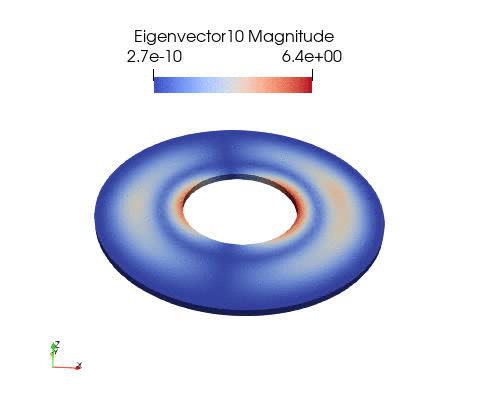

# FEniCS Modal Analysis: Natural Frequencies & Mode Shapes of Annular Disks

[](https://www.python.org/)
[](https://fenicsproject.org/)
[](https://slepc.upv.es/)
[](LICENSE)
[]()

> An open-source object-oriented **Finite Element Method (FEM)** computational tool developed in Python using the **FEniCS** computing platform and **SLEPc** eigensolver to compute **natural frequencies and resonant mode shapes** for 2D and 3D annular disks under arbitrary boundary conditions.

---

## 🌟 Resonant Mode Shapes Gallery (3D Annular Disk)

Below are the 10th resonant mode shapes computed for four classic boundary condition combinations (**Clamped 'C'** and **Free 'F'** on inner and outer boundaries):

| Clamped - Clamped (CC) | Free - Free (FF) |
| :---: | :---: |
|  |  |
| **Clamped - Free (CF)** | **Free - Clamped (FC)** |
|  |  |

---

## 📌 Engineering Background & Problem Statement

In rotating machinery, turbomachinery, brake rotors, and optical disk drives, determining **vibrational mode shapes** and their associated **natural eigenfrequencies** is essential to prevent catastrophic resonance failure under operational excitation speeds.

This package provides a clean, object-oriented abstraction over FEniCS to solve the **generalized algebraic eigenvalue problem** for elastodynamics:

$$\mathbf{K} \boldsymbol{\phi} = \omega^2 \mathbf{M} \boldsymbol{\phi}$$

Where:
* $\mathbf{K}$ is the structural stiffness matrix:
  $$\mathbf{K} = \int_{\Omega} \boldsymbol{\sigma}(\mathbf{u}) : \boldsymbol{\varepsilon}(\mathbf{v}) \, d\Omega$$
* $\mathbf{M}$ is the consistent mass matrix:
  $$\mathbf{M} = \int_{\Omega} \rho \mathbf{u} \cdot \mathbf{v} \, d\Omega$$
* $\boldsymbol{\phi}$ represents the eigenvector (vibrational displacement mode shape).
* $\omega = 2\pi f$ corresponds to the angular natural frequency ($f$ in Hertz).

---

## 🏗️ Architecture & Package Structure

The codebase is organized into modular object-oriented classes:

```text
Fenics_comp_modeshape_disk/
├── comp_modeshape_disk/             # Core Python package
│   ├── Classes/
│   │   ├── DiskMesh.py              # 2D/3D mesh generation, Gmsh loader & XDMF conversion
│   │   ├── Material.py              # Linear elastic constitutive parameters (E, nu, rho)
│   │   └── Simulation.py            # Variational form, SLEPc eigensolver & post-processing
│   └── Methods/                     # Helper calculation and boundary condition tagging routines
├── Geometry/                        # Gmsh geometries (.geo, .msh) and mesh metadata
├── Pictures/                        # High-resolution animated GIFs of resonant mode shapes
├── Simulation2D/                    # 2D modal analysis outputs (CC, CF, FC, FF)
├── Simulation3D/                    # 3D modal analysis outputs (CC, CF, FC, FF)
├── tests/                           # Verification unit tests against analytical solutions
├── main.py                          # Main runnable simulation pipeline script
├── .gitignore                       # Git ignore for caches and large simulation binaries
├── LICENSE                          # MIT License
└── README.md                        # Documentation and user guide
```

---

## 🚀 Quickstart & Usage

### 1. Minimal Working Example (`main.py`)

```python
import comp_modeshape_disk as cmd
from comp_modeshape_disk.Classes.DiskMesh import DiskMesh
from comp_modeshape_disk.Classes.Material import Material
from comp_modeshape_disk.Classes.Simulation import Simulation

# 1. Define Mesh (2D Parametric Annular Disk)
mesh2d = DiskMesh(
    Rint=0.04,  # [m] Inner radius
    Rext=0.10,  # [m] Outer radius
    Rholes=0.0,  # [m] Hole radius
    res=80,  # Mesh resolution
)

# 2. Define Material Properties (Aluminum Alloy / Steel)
mat = Material(
    E=72000 * 1e6,  # Young's Modulus [Pa]
    nu=0.3,  # Poisson's ratio [-]
    rho=2800,  # Density [kg/m^3]
)

# 3. Solve Eigenvalues for Multiple Boundary Conditions
# 'C': Clamped, 'F': Free
for bc in ['CF', 'FF', 'CC', 'FC']:
  sim = Simulation(
      mesh_obj=mesh2d,
      mat_obj=mat,
      bc=bc,
      save_path=f'Simulation2D/{bc}/',
      neig=20,  # Number of eigenmodes to compute
  )
  sim.run()
```

### 2. 3D Mesh Simulation via Gmsh

```python
# Load 3D extruded mesh generated from Gmsh
mesh3d = DiskMesh(
    Rint=0.04,
    Rext=0.10,
    h=0.005,  # [m] Thickness
    load_path='Geometry/',
    mesh_name='annular_disk_3d.msh',
)

sim3d = Simulation(
    mesh_obj=mesh3d,
    mat_obj=mat,
    bc='CF',
    save_path='Simulation3D/CF/',
    neig=20,
)
sim3d.run()
```

---

## ⚙️ Installation & Prerequisites

To run this simulation framework, you need **Python 3** with **FEniCS (DOLFIN)** and **SLEPc/PETSc** installed:

### Option A: Using Conda (Linux / macOS)
```bash
conda create -n fenics -c conda-forge fenics-dolfin slepc4py petsc4py
conda activate fenics
```

### Option B: Using Docker (Windows / macOS / Linux)
If you are on Windows, Docker provides the most reliable way to run FEniCS:
```bash
docker run -ti -v ${PWD}:/home/fenics/shared quay.io/fenicsproject/stable:latest
cd shared
python3 main.py
```

### Option C: Windows Subsystem for Linux (WSL2)
Inside Ubuntu on WSL2:
```bash
sudo apt-get update
sudo apt-get install software-properties-common
sudo add-apt-repository ppa:fenics-packages/fenics
sudo apt-get update
sudo apt-get install --no-install-recommends fenics
```

---

## 👥 Authors & Contributors

* **Duy Duc NGUYEN, Ph.D.** ([@DuyDucNguyen](https://github.com/DuyDucNguyen))
---

## 📄 License

This project is licensed under the **MIT License** - see the [LICENSE](LICENSE) file for details.
